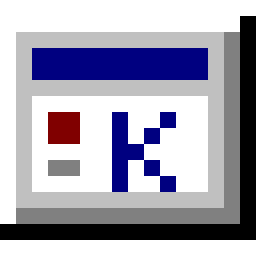
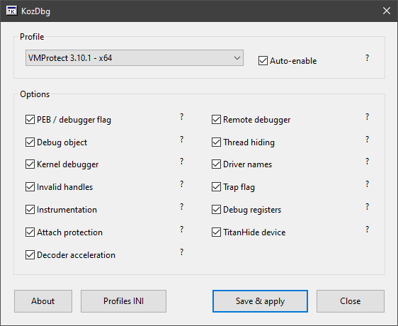
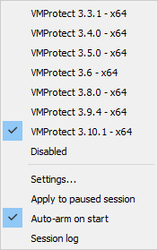

<div align="center">



# KozDbg

**VMProtect anti-anti-debug for x64dbg and x32dbg**

Separate profiles for VMProtect **3.3.1–3.10.1**. Runs entirely in user mode.

  [](https://github.com/ivanpotatoes/KozDbg/releases/latest)

[**Download**](#download) · [Setup](#setup) · [Tested versions](#tested-versions) · [Demos](#demos) · [Research](#research-behind-kozdbg)

<br>



</div>

<br>

I built KozDbg from my research into VMProtect's anti-debug checks. Select the version profile before loading your program, then run it under the debugger. Addresses and syscall numbers are resolved in the target; the profiles do not depend on sample names or fixed addresses.

**No kernel driver is needed, including for 3.10.1 on both architectures.** Supported kernel-debugger queries are handled from user mode.

## Download

| Target program | Package | Debugger |
| :--- | :--- | :--- |
| 64-bit | [**KozDbg v1.1.2 · x64**](https://github.com/ivanpotatoes/KozDbg/releases/download/v1.1.2/KozDbg-v1.1.2-x64.zip) | x64dbg |
| 32-bit | [**KozDbg v1.1.2 · x32**](https://github.com/ivanpotatoes/KozDbg/releases/download/v1.1.2/KozDbg-v1.1.2-x32.zip) | x32dbg |

Both packages include the plugin and default INI files. **Updating? Close the debugger, replace the plugin and keep your existing INI files.**

## Setup

1. Close the debugger. Copy the matching package into its `plugins` folder, beside `x64dbg.exe` or `x32dbg.exe`.
2. Open **Plugins → KozDbg x64** or **Plugins → KozDbg x32** and select the VMProtect version.
3. Leave **Auto-enable** checked, then load the protected executable.
4. At the system breakpoint, look for `profile armed` in the log and press **F9**. If it stops at the entry breakpoint, press **F9** again.

The default profile is **3.3.1**. Choose the profile before running the target. If setup fails, read the log before continuing; changing profiles after a detection will not undo it.

<details>
<summary><strong>Settings files</strong></summary>

| Build | Plugin | Settings |
| :--- | :--- | :--- |
| x64 | `KozDbg.dp64` | `KozDbg.dp64.ini` and `KozDbg.dp64.ini.profiles.ini` |
| x32 | `KozDbg.dp32` | `KozDbg.dp32.ini` |

Settings files are created when needed. Each build has its own settings format; do not rename an x64 INI to use it with x32.

</details>

## Tested versions

| VMProtect | Profile | x64 | x32 |
| :--- | :---: | :---: | :---: |
| 3.3.1 | `331` | Passed | Passed |
| 3.4.0 | `340` | Passed | Passed |
| 3.5.0 | `350` | Passed | Passed |
| 3.6.0 | `360` | Passed | Passed |
| 3.8.0 | `380` | Passed | Passed |
| 3.9.4 | `394` | Passed | Passed |
| 3.10.1 | `3101` | Passed | Passed |

All seven versions were tested on **both architectures**, with a separate profile for each. x32 was tested under WOW64 on 64-bit Windows.

<details>
<summary><strong>What the tests cover</strong></summary>

The x64 tests used the protected programs from the research. The x32 tests used RiddleGame protected with each listed version, including additional protection options. The GUI opens without manual bypass patches.

The 3.9.4 and 3.10.1 x32 runs also passed answer submission, Pause/Resume and user hardware-breakpoint checks. These results cover the tested programs and configurations, not every intermediate VMProtect build.

</details>

## Checks and profiles

The selected profile determines which handlers are available:

| Area | Handled checks |
| :--- | :--- |
| Debugger state | PEB flags, remote debugger and debug object queries |
| Threads and exceptions | Thread hiding, invalid handles and trap-flag exceptions |
| Saved context | Debug registers and instrumentation callback clearing |
| Kernel-related queries | Kernel debugger state, driver names and later TitanHide device checks |
| Attach protection | Remote-breakin protection |

Select a profile from the menu without opening Settings. Hover over **?** beside an option for its explanation. Unavailable options are greyed out.

<p align="center">
  
</p>

**Save & apply** saves your choices and applies them. Pause an already running target first.

On **x64**, open **Profiles INI**, copy an existing section and give it a unique ID and name. Restart x64dbg to load it. [The profile guide](PROFILES.md) describes the format and engines. On **x32**, the same button opens `KozDbg.dp32.ini`, with separate option sections for the seven built-in profiles. Custom named profiles are an x64 feature.

Profiles configure the existing handlers. Supporting a new detection technique requires a code change.

<details>
<summary><strong>Commands</strong></summary>

| Command | Action |
| :--- | :--- |
| `kz_settings` | Open Settings |
| `kz_profile 331` | Select VMProtect 3.3.1 |
| `kz_profile MyProfile` | Select a custom preset on x64 |
| `kz_profile off` | Disable KozDbg |
| `kz_apply` | Apply the profile while paused |
| `kz_status` | Show state and counters |

</details>

<details>
<summary><strong>Packed programs, breakpoints and logging</strong></summary>

Packed programs are supported where their layout is recognized. The x64 decoder acceleration option can reduce startup time.

The x32 WOW64 backend uses hardware breakpoints and memory guards to follow native transitions. It needs a free hardware slot to observe the return and retains existing user breakpoints. Startup time depends on the layout and available slots.

The x64 build counts repeated informational messages instead of repeatedly printing them. The x32 backend records detailed call diagnostics. Errors remain visible; the debugger's own exception logging is separate.

KozDbg handles anti-debug checks. It does not unpack or devirtualize code, solve application key checks or handle anti-VM checks.

</details>

## Demos

The videos show protection setup, profile selection and the programs running under the debugger. Click either image to watch.

<table>
<tr><th>x64 · x64dbg</th><th>x32 · x32dbg</th></tr>
<tr>
<td><a href="https://www.youtube.com/watch?v=r7Q8KtjtaA0"></a></td>
<td><a href="https://www.youtube.com/watch?v=VaEJDaibNfY"></a></td>
</tr>
</table>

## Build from source

<details>
<summary><strong>Requirements and build commands</strong></summary>

Use Windows, Visual Studio 2022 with **Desktop development with C++**, CMake 3.20+ and the [x64dbg plugin SDK](https://github.com/x64dbg/x64dbg).

```powershell
# x64dbg
cmake -S . -B ../KozDbg-build-x64 -A x64 -DX64DBG_SDK="C:/path/to/pluginsdk"
cmake --build ../KozDbg-build-x64 --config Release

# x32dbg
cmake -S . -B ../KozDbg-build-x32 -A Win32 -DX64DBG_SDK="C:/path/to/pluginsdk"
cmake --build ../KozDbg-build-x32 --config Release
```

The SDK must contain `_plugins.h` and the matching libraries: `x64dbg.lib` / `x64bridge.lib` or `x32dbg.lib` / `x32bridge.lib`.

Outputs:

- `../KozDbg-build-x64/Release/KozDbg.dp64`
- `../KozDbg-build-x32/Release/KozDbg.dp32`

Keep separate build directories for the two architectures.

</details>

For [bug reports](https://github.com/ivanpotatoes/KozDbg/issues), include the debugger build and architecture, VMProtect version, protection options, selected profile and relevant log. Mention whether the program runs normally outside the debugger.

## Research behind KozDbg

- [VMProtect 3.3.x–3.5.x anti-debug analysis](https://ivankozlovsky.com/blog/vmprotect-33x-35x-anti-debug-analysis)
- [VMProtect 3.6 anti-debug analysis](https://ivankozlovsky.com/blog/vmprotect-36-anti-debug-analysis)
- [VMProtect 3.8.0 anti-debug analysis](https://ivankozlovsky.com/blog/vmprotect-380-anti-debug-analysis)
- [VMProtect 3.9.4 anti-debug analysis](https://ivankozlovsky.com/blog/vmprotect-394-anti-debug-analysis)
- [VMProtect 3.10.1 anti-debug analysis](https://ivankozlovsky.com/blog/vmprotect-3101-anti-debug-analysis)

---

**Ivan Kozlovsky** · [Website](https://ivankozlovsky.com) · [Email](mailto:contact@ivankozlovsky.com) · [PGP](https://ivankozlovsky.com/pgp.asc)

Released under the [MIT license](LICENSE).

## Star history

[](https://www.star-history.com/?repos=ivanpotatoes%2Fkozdbg&type=date&legend=top-left)
