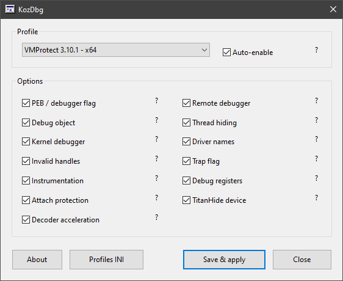
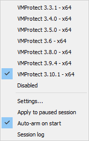

# KozDbg

An anti-anti-debug plugin for **x64dbg and x32dbg**, built from my research into VMProtect's anti-debug checks. It supports the tested versions from **3.3.1 to 3.10.1**, with a separate profile for each version.

> **No kernel driver required — including the VMProtect 3.10.1 profile.**
>
> Both builds run entirely in user mode, including the 3.10.1 profiles. Supported kernel-debugger queries are handled from user mode too, without installing or loading a driver.

**x64 and x32 | Separate version profiles | No kernel driver | MIT license**

[Download](https://github.com/ivanpotatoes/KozDbg/releases/latest) · [x64 demo](https://www.youtube.com/watch?v=r7Q8KtjtaA0) · [x32 demo](https://www.youtube.com/watch?v=VaEJDaibNfY) · [Profile format](PROFILES.md) · [Report a bug](https://github.com/ivanpotatoes/KozDbg/issues)



## Getting started

Use **x64dbg** for 64-bit programs and **x32dbg** for 32-bit programs. Match the plugin to the debugger:

| Debugger | Plugin | Settings |
|---|---|---|
| x64dbg | `KozDbg.dp64` | `KozDbg.dp64.ini` and `KozDbg.dp64.ini.profiles.ini` |
| x32dbg | `KozDbg.dp32` | `KozDbg.dp32.ini` |

**v1.1.2 includes both builds.** Download [KozDbg-v1.1.2-x64.zip](https://github.com/ivanpotatoes/KozDbg/releases/download/v1.1.2/KozDbg-v1.1.2-x64.zip) or [KozDbg-v1.1.2-x32.zip](https://github.com/ivanpotatoes/KozDbg/releases/download/v1.1.2/KozDbg-v1.1.2-x32.zip). Each ZIP includes the matching plugin and default INI files. When updating, keep your existing INI files.

1. Close the debugger and place the matching plugin in its `plugins` folder, beside `x64dbg.exe` or `x32dbg.exe`.
2. Open the debugger. Under **Plugins > KozDbg x64** or **KozDbg x32**, select the VMProtect version.
3. Leave **Auto-enable** checked and load the protected executable.
4. At the system breakpoint, check the log for `profile armed`, then press **F9**. If the debugger stops at the entry breakpoint, press **F9** again.

Settings files are created when needed. The default profile is **3.3.1**. Select the profile before running the target; changing it after detection has already happened will not undo that result. If setup fails, check the log.

**Updating:** replace only the matching `.dp64` or `.dp32` file while the debugger is closed. Keep your existing INI files. The two builds use separate settings; do not rename an x64 INI to use it with x32.

## Supported and tested versions

| VMProtect | Profile | x64 / x64dbg | x32 / x32dbg |
|---|---|---|---|
| 3.3.1 | `331` | Tested - passed | Tested - passed |
| 3.4.0 | `340` | Tested - passed | Tested - passed |
| 3.5.0 | `350` | Tested - passed | Tested - passed |
| 3.6.0 | `360` | Tested - passed | Tested - passed |
| 3.8.0 | `380` | Tested - passed | Tested - passed |
| 3.9.4 | `394` | Tested - passed | Tested - passed |
| 3.10.1 | `3101` | Tested - passed | Tested - passed |

**All seven versions listed above were tested on both architectures.** Each has its own selectable profile.

The x64 tests used the protected test programs from the research. The x32 tests used RiddleGame protected with each listed version, including additional protection options. The GUI opens after startup without manual bypass patches. The 3.9.4 and 3.10.1 x32 runs also passed answer submission, Pause/Resume and user hardware-breakpoint checks.

The x32 backend was tested under WOW64 on 64-bit Windows. These results cover the supplied test programs, not every protected binary or every intermediate VMProtect build.

## What the plugin does

KozDbg handles the supported checks from user mode, including queries about kernel debugger state. It does not install a driver.

Depending on the selected profile, it covers:

- PEB debugger flags, remote debugger and debug object queries
- Thread hiding, kernel debugger queries and driver-name checks
- Invalid handles, trap-flag exceptions and saved debug registers
- Instrumentation callback clearing and remote-breakin protection
- TitanHide device checks in the later profiles

API addresses and syscall numbers are resolved in the target process. Profiles are not tied to the sample programs or fixed protected-code addresses.

Packed programs are supported where the layout is recognized. The x64 decoder acceleration option can reduce startup time. The x32 WOW64 backend also uses hardware breakpoints and memory guards to follow native transitions; it needs a free hardware slot to observe the return. Existing user breakpoints are retained. Startup time depends on the code layout and available slots. Protection settings and code layout still matter, so please report samples that behave differently.

KozDbg handles anti-debug checks. Unpacking, devirtualization, application key checks and anti-VM checks are outside its scope.

## Profiles and controls

You can select a profile directly from the menu without opening Settings.



In Settings, hover over the **?** beside an option to see what it does. Unsupported controls are greyed out for that profile. **Save & apply** saves the selected options and applies them; pause the target first if it is already running.

On **x64**, to create a preset, open **Profiles INI**, copy an existing section and give it a unique ID and name. Restart x64dbg to load it. See [PROFILES.md](PROFILES.md) for an example and the available engines.

On **x32**, **Profiles INI** opens `KozDbg.dp32.ini`. The seven built-in version profiles have separate option sections. Custom named profiles are currently an x64 feature.

INI profiles select options in the existing implementation. A new detection technique needs a C++ change, not just another profile name.

| Command | Action |
|---|---|
| `kz_settings` | Open Settings |
| `kz_profile 331` | Select VMProtect 3.3.1 |
| `kz_profile MyProfile` | Select your own preset (x64) |
| `kz_profile off` | Disable KozDbg |
| `kz_apply` | Apply the selected profile while paused |
| `kz_status` | Show the current state and counters |

The x64 build counts repeated plugin information messages instead of flooding the log. The x32 backend currently records detailed call diagnostics. Errors are still printed. x64dbg's own exception logging is separate.

## Demo

Click a thumbnail to watch on YouTube.

### x64 demo

BasicProbe, RiddleGame and KeyCheck protected with different VMProtect versions, then run in x64dbg with KozDbg.

[](https://www.youtube.com/watch?v=r7Q8KtjtaA0)

### x32 demo

KozDbg running in x32dbg with 32-bit programs.

[](https://www.youtube.com/watch?v=VaEJDaibNfY)

## Build from source

Use Windows, Visual Studio 2022 with **Desktop development with C++**, CMake 3.20+ and the [x64dbg plugin SDK](https://github.com/x64dbg/x64dbg).

```powershell
# x64dbg
cmake -S . -B ../KozDbg-build-x64 -A x64 -DX64DBG_SDK="C:/path/to/pluginsdk"
cmake --build ../KozDbg-build-x64 --config Release

# x32dbg
cmake -S . -B ../KozDbg-build-x32 -A Win32 -DX64DBG_SDK="C:/path/to/pluginsdk"
cmake --build ../KozDbg-build-x32 --config Release
```

The SDK folder must contain `_plugins.h` and the matching libraries: `x64dbg.lib` / `x64bridge.lib` or `x32dbg.lib` / `x32bridge.lib`. The outputs are `../KozDbg-build-x64/Release/KozDbg.dp64` and `../KozDbg-build-x32/Release/KozDbg.dp32`. Use separate build directories for the two architectures.

For bug reports, include your debugger build and architecture, VMProtect version, protection options, selected profile and the relevant KozDbg log. Mention whether the same program runs normally outside the debugger.

## Research behind KozDbg

- [VMProtect 3.3.x–3.5.x anti-debug analysis](https://ivankozlovsky.com/blog/vmprotect-33x-35x-anti-debug-analysis)
- [VMProtect 3.6 anti-debug analysis](https://ivankozlovsky.com/blog/vmprotect-36-anti-debug-analysis)
- [VMProtect 3.8.0 anti-debug analysis](https://ivankozlovsky.com/blog/vmprotect-380-anti-debug-analysis)
- [VMProtect 3.9.4 anti-debug analysis](https://ivankozlovsky.com/blog/vmprotect-394-anti-debug-analysis)
- [VMProtect 3.10.1 anti-debug analysis](https://ivankozlovsky.com/blog/vmprotect-3101-anti-debug-analysis)

## Author

**Ivan Kozlovsky** · [ivankozlovsky.com](https://ivankozlovsky.com) · [contact@ivankozlovsky.com](mailto:contact@ivankozlovsky.com) · [PGP](https://ivankozlovsky.com/pgp.asc)

Released under the [MIT license](LICENSE).

## Star history

[](https://www.star-history.com/?repos=ivanpotatoes%2Fkozdbg&type=date&legend=top-left)
