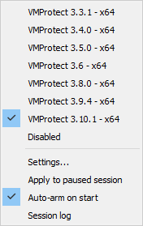
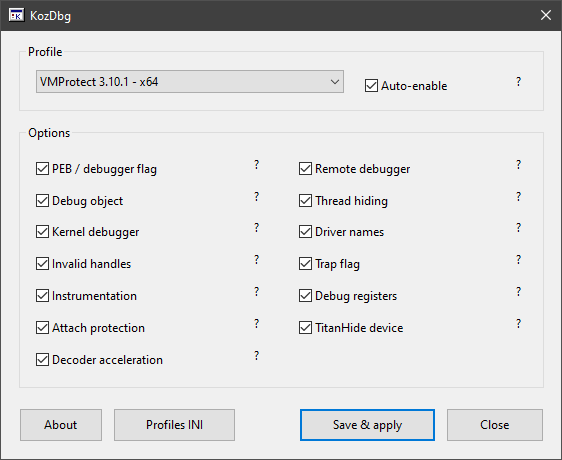
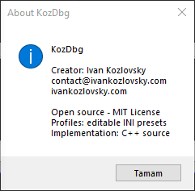

# KozDbg

**An open-source x64dbg anti-anti-debug plugin for VMProtect 3.3.x–3.10.x.**

KozDbg is built from my VMProtect research, covering the tested versions from **3.3.1 through 3.10.1**. Select the matching profile, load the protected program and continue debugging.

**No kernel driver is required.** KozDbg runs as an x64dbg plugin and handles the supported user-mode and kernel-debugger detection checks from user mode. It supports native x64 programs.

Created by **Ivan Kozlovsky** · [Website](https://ivankozlovsky.com) · [Source](https://github.com/ivanpotatoes/kozdbg)

## Supported versions

| VMProtect version | Profile | Engine |
|---|---|---|
| 3.3.1 | `331` | API interception |
| 3.4.0 | `340` | API interception |
| 3.5.0 | `350` | API interception |
| 3.6 | `360` | Clustered direct syscalls |
| 3.8.0 | `380` | Scattered direct syscalls |
| 3.9.4 | `394` | Scattered direct syscalls with extended checks |
| 3.10.1 | `3101` | Scattered direct syscalls with extended checks |

These are the specific versions researched and tested. The 3.3.x–3.10.x range describes the covered release families; it does not mean every intermediate build has been tested. Version selection is manual.

## Demo

[](https://www.youtube.com/watch?v=r7Q8KtjtaA0)

[Watch the example tests on YouTube](https://www.youtube.com/watch?v=r7Q8KtjtaA0)

The video shows BasicProbe, RiddleGame and KeyCheck being protected with different VMProtect versions, then run under x64dbg with KozDbg.

## Installation

1. Download `KozDbg.dp64` from [Releases](https://github.com/ivanpotatoes/KozDbg/releases/latest), or build it using the instructions below.
2. Copy it into the `plugins` directory next to `x64dbg.exe`.
3. Start x64dbg and open **Plugins > KozDbg**.
4. Select the matching VMProtect profile and leave **Auto-enable** checked.
5. Load the protected program. At the system breakpoint, check that the log reports the profile as armed, then press **F9**. The entry breakpoint may require another **F9**.

Select the profile before starting the target. Applying it after a check has already run cannot undo that check. If arming fails, check the reported error before continuing.

When updating, close x64dbg completely before replacing the plugin. Keep your existing `KozDbg.dp64.ini` and `KozDbg.dp64.ini.profiles.ini` files.

## Interface

Profiles can be selected directly from the Plugins menu. Opening the settings window is optional.




The settings window exposes the individual controls. Hover over a question mark for an explanation, or use **Profiles INI** to edit your presets.





## What it handles

The available controls depend on the selected version:

- PEB and debugger API checks.
- Remote debugger, debug object and kernel debugger queries.
- Thread hiding, driver-name checks and supported invalid-handle checks.
- Trap-flag exception delivery and saved debug registers.
- Instrumentation callback and remote-breakin protection in later profiles.
- The TitanHide device check in 3.9.4 and 3.10.1.
- Decoder acceleration for recognized packed layouts.

API addresses and syscall numbers are resolved in the running process. There are no fixed protected-code addresses, sample names or hashes used to select the target.

Native API breakpoints preserve the validated syscall identification bytes. This also addresses the packed 3.3.1 case tested with RiddleGame.

## Custom profiles

Open **Settings > Profiles INI**, copy an existing section and give it a new ID. Change the name and options, then restart x64dbg. The new profile appears in both the menu and the settings dropdown.

Profiles configure the existing engines. Adding support for a new detection technique still requires changing and rebuilding the C++ implementation.

See [PROFILES.md](PROFILES.md) for the format and an example.

## Commands

| Command | Action |
|---|---|
| `kz_settings` | Open settings |
| `kz_profile 331` | Select the 3.3.1 profile |
| `kz_profile MyProfile` | Select a custom profile |
| `kz_profile off` | Disable KozDbg |
| `kz_apply` | Apply the selected profile while paused |
| `kz_status` | Show state and hit counters |

Repeated informational messages are counted instead of printed continuously. Errors remain visible. x64dbg's own exception messages are separate.

## Building

Requirements: Windows, Visual Studio 2022 with **Desktop development with C++**, CMake 3.20 or newer, and the [x64dbg plugin SDK](https://github.com/x64dbg/x64dbg).

```powershell
cmake -S . -B ../KozDbg-build -A x64 -DX64DBG_SDK="C:/path/to/pluginsdk"
cmake --build ../KozDbg-build --config Release
```

The SDK directory must contain `_plugins.h`, `x64dbg.lib` and `x64bridge.lib`. The compiled plugin is written to `../KozDbg-build/Release/KozDbg.dp64`.

## Packed programs and limitations

Decoder acceleration handles recognized packed layouts and needs a safe hardware-breakpoint slot. If one is unavailable, the memory-guard path stays in use and startup can be slower.

Different protection options can change the code layout. Passing the supplied examples does not establish compatibility with every protected program.

KozDbg handles anti-debug checks. It does not unpack programs, devirtualize code, bypass application key checks or handle anti-VM checks.

## Research

- [VMProtect 3.3.x–3.5.x anti-debug analysis](https://ivankozlovsky.com/blog/vmprotect-33x-35x-anti-debug-analysis)
- [VMProtect 3.6 anti-debug analysis](https://ivankozlovsky.com/blog/vmprotect-36-anti-debug-analysis)
- [VMProtect 3.8.0 anti-debug analysis](https://ivankozlovsky.com/blog/vmprotect-380-anti-debug-analysis)
- [VMProtect 3.9.4 anti-debug analysis](https://ivankozlovsky.com/blog/vmprotect-394-anti-debug-analysis)
- [VMProtect 3.10.1 anti-debug analysis](https://ivankozlovsky.com/blog/vmprotect-3101-anti-debug-analysis)

## Contact

**Ivan Kozlovsky**  
[ivankozlovsky.com](https://ivankozlovsky.com)  
[contact@ivankozlovsky.com](mailto:contact@ivankozlovsky.com)  
[PGP public key](https://ivankozlovsky.com/pgp.asc)

## License

[MIT](LICENSE)
